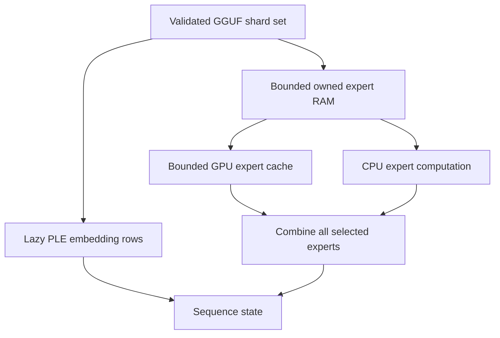

# Native engine architecture

ForgeAI contains **one native Rust inference runtime**, with historical
`forge9070` and `forge-engine` executable aliases entering the same implementation.
The Strata compatibility service and port 8080 have been retired.

## Execution policy and hardware

The native runtime keeps CPU, resident Vulkan and diagnostic hybrid execution
behind one model interface. Vulkan adapter eligibility comes from API version,
compute queues, kernel limits and memory capabilities, not a vendor ID or model
name. The same native kernels target eligible AMD, NVIDIA and Intel hardware.

`--backend auto` resolves to Vulkan when eligible hardware exists, otherwise
CPU. The resolution precedes host-memory planning, and reports the requested
policy, chosen backend and reason. Explicit device, VRAM budget or software
Vulkan test settings forbid silent fallback. Failures in model loading, shader
compilation and device allocation remain errors.

This is capability selection, not a CUDA, HIP or Metal implementation or
physical GPU performance proof. See [hardware support](HARDWARE-SUPPORT.md).

## Model storage and expert execution

This is a data-flow diagram, not a promise that transfer and compute overlap.
Expert leases protect entries while in use. Prefill misses do not evict the
protected decode working set. Cache budgets account for owned payload; other
runtime and OS allocations still need headroom. The engine retains every
selected expert. When its packed working set cannot fit the GPU expert budget,
the native path can compute that expert on the CPU and counts the fallback.

GGUF metadata, shards, tensor dimensions and quantization formats are checked
before loading. The selected checkpoint still has to allocate and execute
successfully. Sparse embedding tables remain separately mapped and accessed
as required. See [the native guide](NATIVE-ENGINE.md) and
[the source comparison](AVALON-COMPARISON.md).

## Service lifecycle

1. The service can start without a model, exposing its configuration panel; fresh settings use the `auto` backend policy.
2. The catalog scans a bounded folder tree and validates complete model sets.
3. Configuration changes require an idle service. Loading applies the model
   and runtime settings; a failure attempts restoration of the previous state.
4. Requests validate their model ID, prompt/output budget and supported options
   before inference. Independent sequence slots share the loaded weights.
5. Busy requests wait in a bounded queue. Saturated queues reject additional
   work. Cancellation and request state remain per sequence.
6. Successful settings changes can persist to the explicit profile path.
   Credentials are not persisted by the configuration API.

The default UI and API listen on loopback at port 9070. The embedded UI has no
frontend build or CDN dependency. Tool-call output is passed to the client;
the inference service does not execute arbitrary client tools.

## Runtime boundaries

| Boundary | Meaning |
| --- | --- |
| One loaded checkpoint | A model ID in a chat request does not download or silently switch models. |
| One to four active slots | Independent sequence capacity, subject to state and device budgets; not continuous batching. |
| Vulkan adapter | Capability-based discovery is distinct from successful kernel execution and model fit. |
| Automatic policy | Resolves before model loading and never masks model, shader or execution failures. |
| WSL process type | A Linux process uses Linux paths and drivers; a Windows executable launched from WSL remains a Windows process. |
| CPU/software Vulkan tests | Useful numerical and service checks, not real hardware performance evidence. |
| Model file size | Disk footprint; not the same quantity as owned cache size or peak memory use. |

## Source map

The native crate is [`crates/forge-engine`](../crates/forge-engine).
Server control and UI code are under its `src/server` and `src/ui` directories.
The historical command alias lives at [`src/main.rs`](../src/main.rs),
while the bounded local context packer remains at
[`src/code_context.rs`](../src/code_context.rs) and compiles into the native
crate. The old Strata runtime has been deleted. Historical attribution and
licence text are retained in [third-party notices](../THIRD_PARTY_NOTICES.md).
